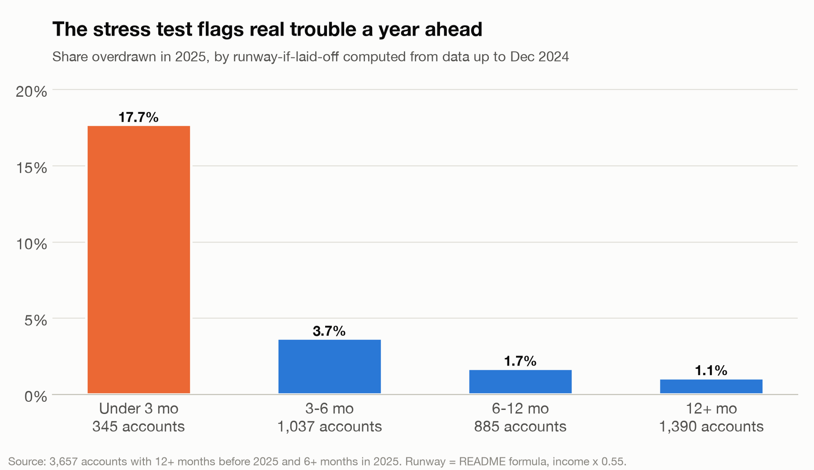
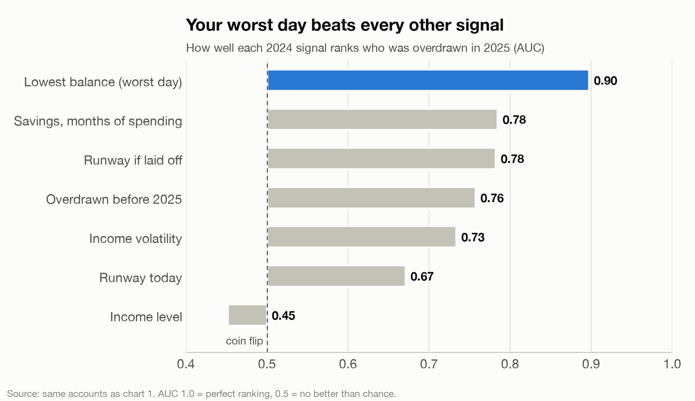
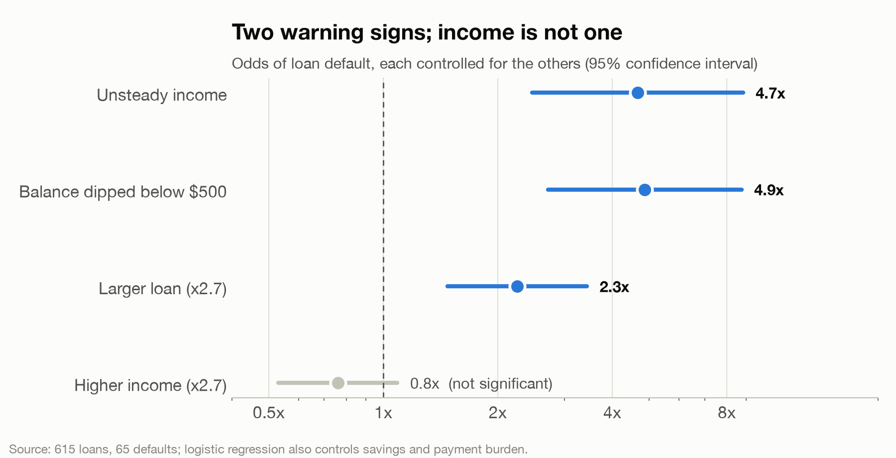
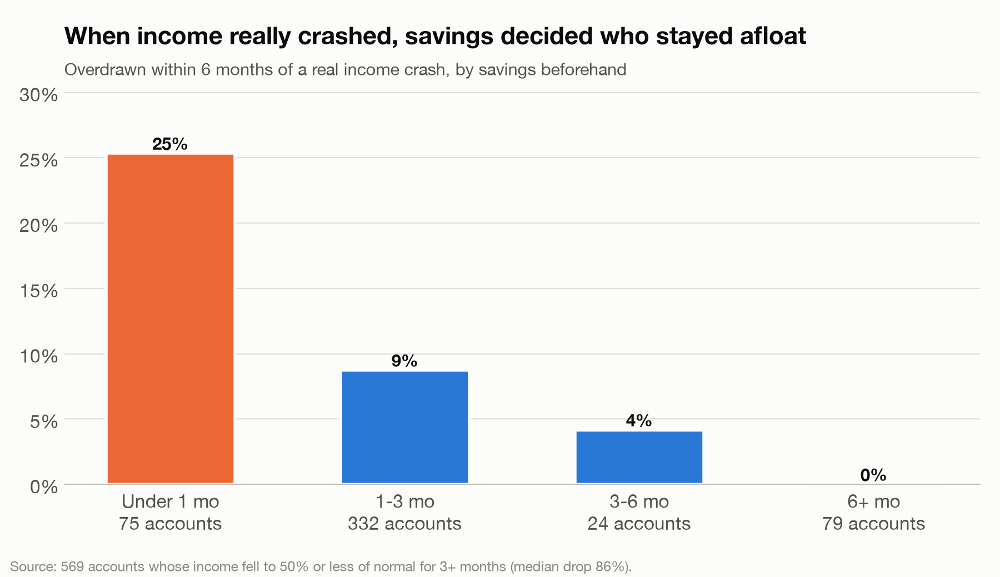
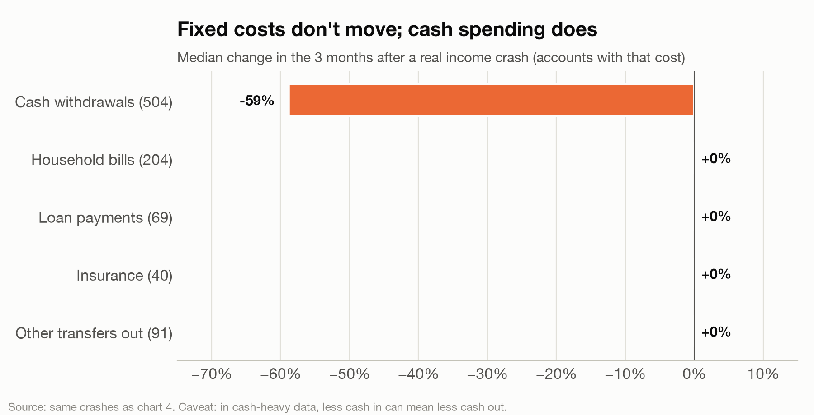
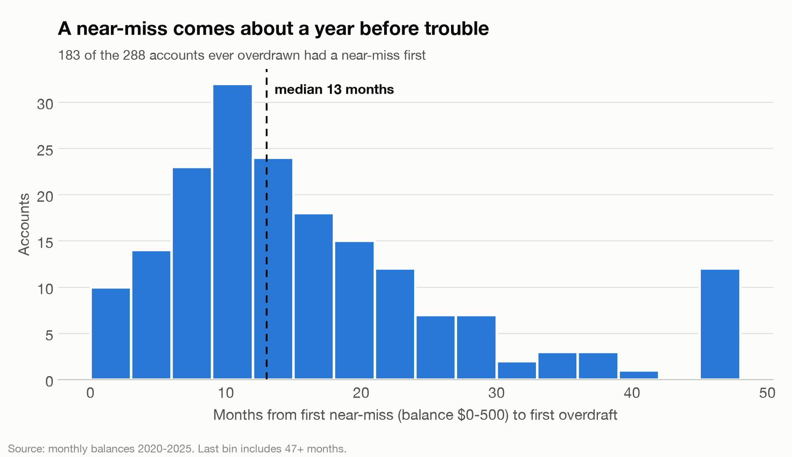
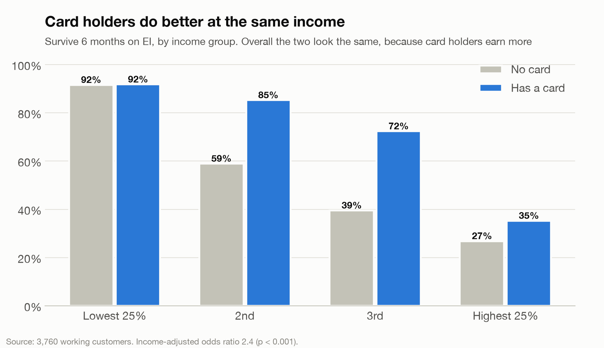

# Findings: what predicts financial trouble

Step-by-step walkthrough with all code and charts: [`findings_walkthrough.ipynb`](findings_walkthrough.ipynb) (already executed; GitHub renders it).
How to use these in the plan: [`PLAN_SPEC.md`](PLAN_SPEC.md).

Data: Tangerine datathon data (PKDD'99 Financial dataset, 4,500 accounts, 2020-2025, CAD, shifted dates).
Everything below is recomputed in `findings_walkthrough.ipynb` from `data/data/*.csv`; runway uses the README formula (`findings/engine/core.py`).
To rerun: `uv pip install -r findings/requirements.txt`, then open the notebook from inside `findings/`.

## 1. The stress test predicts real trouble (out-of-time validation)
Runway computed from data **up to Dec 2024** vs who was actually **overdrawn in 2025** (3,657 accounts, 129 overdrawn).

| Runway if laid off on EI (2024 data) | Overdrawn in 2025 |
|---|---|
| under 3 months (345) | 17.7% |
| 3-6 months (1,037) | 3.7% |
| 6-12 months (885) | 1.7% |
| 12+ months (1,390) | 1.1% |

AUC: runway-if-laid-off 0.78 [0.74, 0.83] vs runway today 0.67 [0.62, 0.72]. Stress-testing beats the plain number.

## 2. Near-misses predict crashes
The lowest balance in the past 12 months is the best single predictor of a 2025 overdraft:
AUC 0.90 [0.87, 0.93]; 0.81 [0.75, 0.86] even among accounts never overdrawn before.
The README runway uses the *average* balance and misses this. Income level predicts nothing (AUC 0.45).
Caveat: partly mechanical (a balance near zero is close to negative), which is why the never-overdrawn test matters.

## 3. Two independent warning signs for default; income is not one
Logistic regression, 615 loans, 65 defaults, controlling for income, savings, loan size and payment burden:
- unsteady income (month-to-month variation >= 50%): odds ratio 4.7 [2.5, 8.8]
- balance dipped below $500 in the year before the loan: 4.9 [2.7, 8.8]
- income level: 0.76 [0.53, 1.09], not significant
- (loan size: 2.3 [1.5, 3.4])

## 4. Higher earners are less resilient to a job loss
Working customers, excluding side-account-like accounts (savings over 12 months of spending), n = 3,465:

| Income quarter | Median income | Savings (months of spending) | Survive 6 months on EI |
|---|---|---|---|
| Q1 | $2,390 | 6.6 | 85% |
| Q2 | $7,961 | 2.9 | 56% |
| Q3 | $12,505 | 2.5 | 48% |
| Q4 | $20,351 | 1.8 | 29% |

The shock is the same relative size for everyone (gap about 42-43% of spending); the difference is that
savings do not keep up with spending as income rises.

## 5. Real income crashes: savings decide who stays afloat
569 accounts had income fall to <= 50% of normal for 3+ months (median drop 86%).
Overdrawn within 6 months: 25% with under 1 month of savings, 9% with 1-3, 4% with 3-6, 0% with 6+.
People cut spending by a median 60% after the crash, so the README formula (spending unchanged) is a worst case.
Caveat: in this cash-heavy data, less money in may mechanically mean less cash out.
(An earlier note that crashes cluster in January was an artifact; see "Nulls and corrections".)

## Also
- One job loss on EI: 35.5% of all customers run out within 6 months (README formula).
- January: median spending $11,518 vs $4,392 in February.
- Borrowers survive a 6-month EI shock far less often (13-39%) than non-borrowers (70%).
- District, gender: no meaningful difference.

## More findings

### 6. A near-miss gives about a year's warning
Of the 288 accounts ever overdrawn, 64% first had a near-miss (balance between $0 and $500).
Median time from that near-miss to the first overdraft: 13 months (IQR 8-21).

### 7. In real income crashes, fixed costs don't move; cash spending does
In the 569 real crashes, 3 months after vs the prior 12-month median:
cash withdrawals -59% (504 accounts); household bills, insurance, loan payments and other transfers all +0%.
Fixed costs are the trap, and "cut flexible spending" is what people really do.
Caveat: cash-heavy data, so less money in may mechanically mean less cash out.

### 8. Borrowers are fragile beyond their income, even after repaying
Workers, odds of surviving 6 months on EI: borrower OR 0.29 raw, 0.54 [0.45, 0.65] after controlling for income.
Top-half earners: no loan 44%, repaid 27%, running OK 32%, in debt 18%, defaulted 11%.
Checked: not a formula artifact (README spending is within 2% of real spending after the loan ends).

### 9. Card holders are more resilient at the same income (hidden by income)
Raw survival is identical (59% vs 58%), but controlling for income: OR 2.39 (p < 0.001).
Card holders earn more, which lowers survival and masks the effect.

### 10. Overdrafts are usually short
93% recover within the data; median 2 months to a full positive month; median 3 months overdrawn in total.

### Nulls and corrections
- Shared accounts (two people): no difference (adjusted OR 1.09, p = 0.38).
- Correction: the earlier "income crashes cluster in January" was an artifact of how the first crash per account was picked;
  low-income months are equally common in every month (about 8%). January's spending spike (money out) still stands.
- Pension income is far steadier than work income (median volatility 0.12 vs 0.27).

## Charts

Earlier EDA charts (same folder): `1_income_vs_survival.png`, `2_savings_months_by_income.png`, `3_steadiness_default.png`,
`4_worst_day_default.png`, `5_seasonality.png`, `6_loans_vs_survival.png`.
